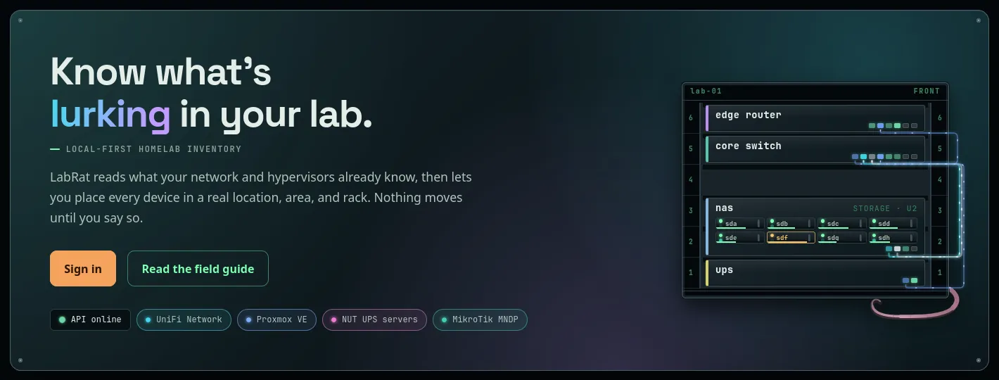
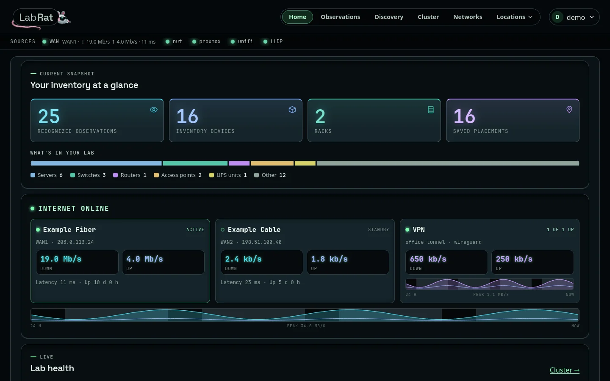
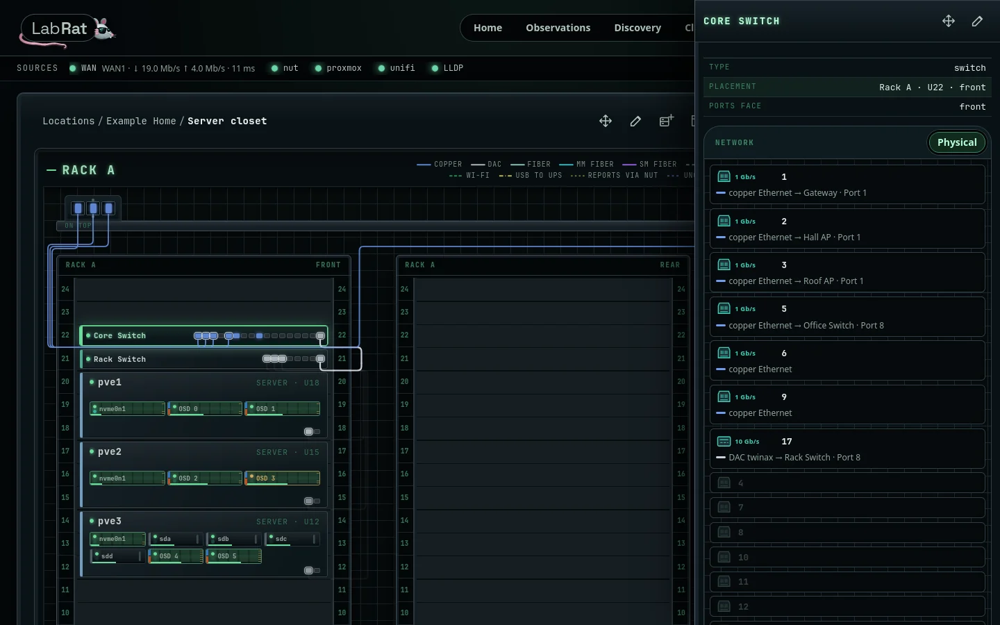
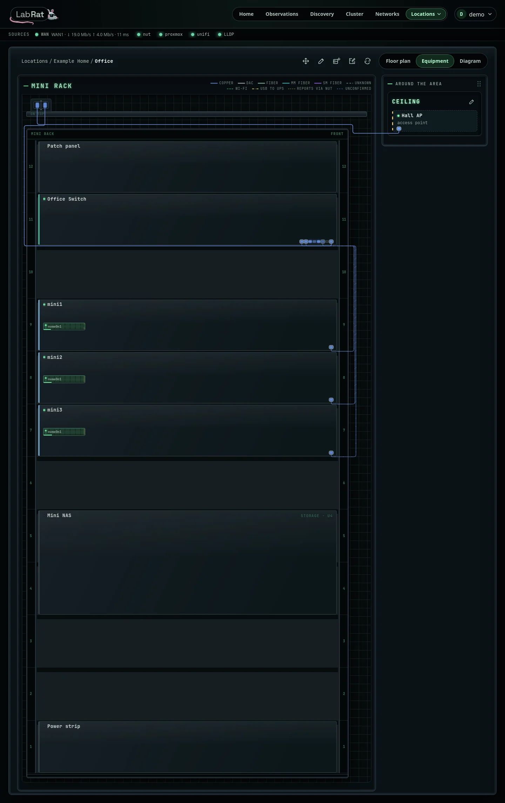
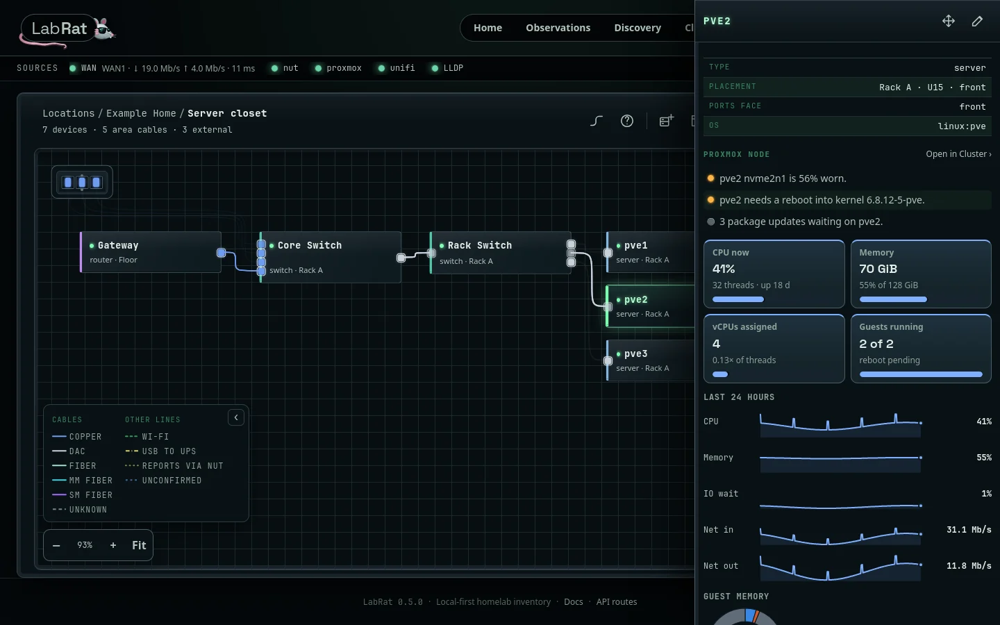
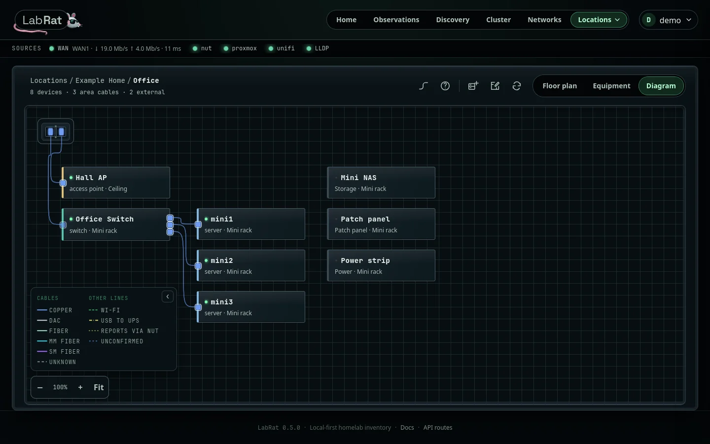
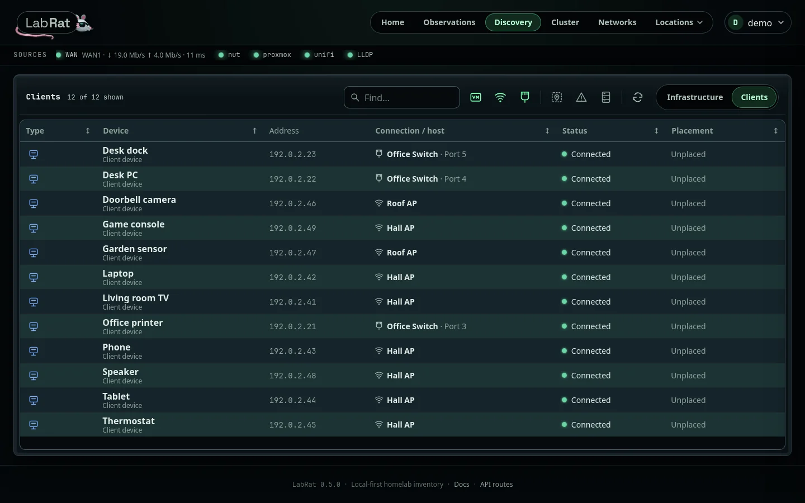
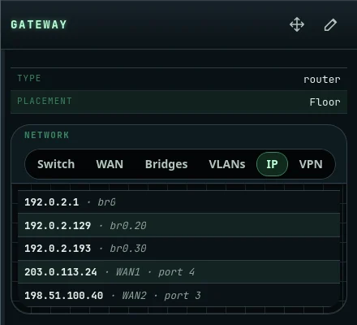

# LabRat 🐀



*Know what's lurking in your lab.*

LabRat is a self-hosted discovery and physical inventory app for home labs.
A read-only collector asks your controllers what they know (switches,
ports, links, servers, clients, UPSes) and LabRat draws it as the lab
really is: racks to scale, front and rear, with the cables between the
ports they use. What it discovers stays separate from your inventory until
you place or link it, so a scan never rearranges your racks.



### Your racks, cabled the way they really are

Every rack is drawn to scale, front and rear, with each device's real port
lamps and the cables between the ports they use. Select a device for its
ports, links, and placement.



Mini racks too: a 10-inch, front-only rack is drawn at the same scale as
its full-size neighbors.



### Wiring you can read

Each area's Diagram lays its equipment out left to right from the internet,
showing only wired ports. Select a server to light its route back to the
gateway; cables leaving the room end on a patch panel along the top.

<table>
  <tr>
    <td></td>
    <td></td>
  </tr>
  <tr>
    <td>Server closet: pve2's route to the gateway</td>
    <td>Office: a mini-rack switch and three mini PCs</td>
  </tr>
</table>

### Every client, and every link

<table>
  <tr>
    <td width="68%"></td>
    <td></td>
  </tr>
  <tr>
    <td>Clients: wired and Wi-Fi endpoints and where they connect</td>
    <td>A gateway's addresses, by interface</td>
  </tr>
</table>

## Read-only by design

- The collector only reads. It never changes a controller's settings, logs
  in to a device to change it, or sends a UPS a command.
- It contacts the controllers you connect and, beyond them, only the
  networks you allow in Settings.
- Credentials stay in `local_config.toml`, never in the database. A
  whole-install export includes them, with a warning, to move LabRat.
- Discovery never moves your equipment: placement and cabling change only
  when you change them.

## What it reads

| Source | What LabRat gets | What it needs |
|---|---|---|
| **UniFi Network** (UniFi OS consoles, or a self-hosted Network application) | Switches, gateways, and access points; ports, link state, PoE, and cables (from uplinks and LLDP); clients; networks, Wi-Fi, firewall zones; WAN and VPN status | A read-only API key |
| **Proxmox VE** | Nodes, physical NICs, bonds, bridges, and VLANs; guests and their NICs; storage, drives, and Ceph; live load and memory | An API token with read-only access (`Sys.Audit`; `VM.Audit` on `/vms` to recognize guests) |
| **Pi-hole** | Today's queries, blocking state, history, and top domains and clients | An application password (v6) or API token (v5) |
| **Network UPS Tools** | UPS status, load, battery, and runtime from NUT servers it finds | Permission to scan the networks they are on; read-only list commands, no login |
| **SNMPv3** (optional) | NIC link state and addresses for Proxmox nodes the API leaves out | A read-only SNMPv3 user on those nodes |
| **MikroTik MNDP** (optional) | MikroTik devices announcing themselves on the local segment | Nothing: it only listens, and needs to share a network segment with them |

New sources plug into the same read-only adapter contract; see the
[collector guide](docs/discovery-adapters.md#adding-an-adapter).

## Quick start

With Docker and Compose:

```sh
git clone <this repository> labrat && cd labrat
mkdir -p deploy/data deploy/config
export LABRAT_UID=$(id -u) LABRAT_GID=$(id -g)
LABRAT_ALLOWED_HOSTS=labrat.example.lan \
  docker compose -f deploy/compose.yaml up -d --build
docker compose -f deploy/compose.yaml logs web | grep "setup code"
```

Open `http://<host>:8000`, choose **First-time setup**, and enter the setup
code from the log to create the administrator. Then connect your
controllers under **Settings → Integrations**.

Prefer to run it from a checkout? It needs Python 3.11 or newer:

```sh
python3 -m venv .venv
.venv/bin/python -m pip install -e .
cp local_config.example.toml local_config.toml   # then set [auth] secret_key
.venv/bin/alembic -c alembic.ini upgrade head
.venv/bin/gunicorn -c gunicorn.conf.py labrat.app:app
.venv/bin/python -m labrat.collector --once      # in another terminal
```

## Learn more

- [Setup guide](docs/setup.md): configuration, connecting controllers,
  what the collector may scan, running it, HTTPS, containers, and upgrades.
- [Tour](docs/tour.md): every page, from Home to the rack Equipment view.
- [Collector guide](docs/discovery-adapters.md): what each source reads,
  exactly, and how to add an adapter.
- [Database schema](docs/database-schema.md).
- The same guides, illustrated, ship inside the app at `/docs`, with every
  screenshot taken from an invented demo lab.

## Contributing and security

Contributions are welcome; [CONTRIBUTING.md](CONTRIBUTING.md) covers setup,
the test gate, and conventions. Please report security problems privately,
as [SECURITY.md](SECURITY.md) explains.

## License

Apache License 2.0; see [LICENSE](LICENSE).
