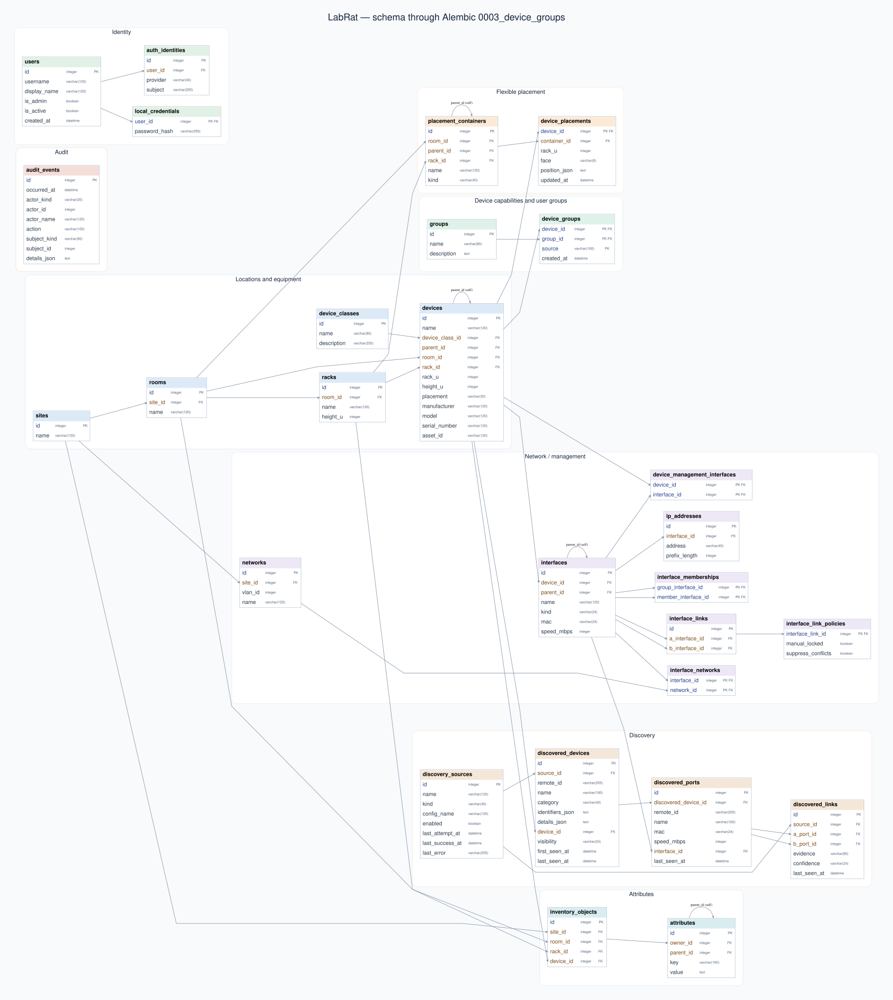

# LabRat database schema

The current schema is at Alembic revision `0015_user_session_version` and
contains 29 application tables. The diagrams are historical snapshots:
[`schema-erd.svg`](schema-erd.svg) depicts revision
`0002_discovery_foundation`, and [`schema-erd-groups.svg`](schema-erd-groups.svg)
depicts revision `0003_device_groups`. Revisions 0004 through 0011 add columns,
indexes, constraints, triggers, and default rows without adding tables. Revision
0012 adds a table for source-scoped logical network interfaces, and 0013 adds a
column; 0014 adds the shared observation-ignore policy table, and 0015 adds
`users.session_version`, which lets an account's sessions be ended. Their arrows represent SQLite
foreign keys present at the respective snapshot. The `.dot` files are editable
Graphviz sources. SQLAlchemy models and Alembic migrations—not the diagrams—are
authoritative.

## Existing foundation (0001)

- `sites` contain `rooms`; rooms contain `racks`.
- `devices` may have parent devices (such as BMC hardware). Devices own
  `interfaces`, including physical ports and logical VLAN/bond interfaces.
- `interface_memberships` associates bond/bridge interfaces with their members.
- `interface_links` represents canonical network cables between **interfaces**,
  rather than simply between devices. `interface_networks` associates interfaces
  with potentially several VLANs; `ip_addresses` belong to interfaces.
- `device_management_interfaces` links a device with an interface that may be
  owned by a nested controller.
- `users`, `local_credentials`, and `auth_identities` separate internal accounts,
  local password hashes, and future external SSO identities.

## Discovery foundation and extensible attributes (0002)

### Extensible attributes

- `inventory_objects` provides **one** durable attribute owner identity for a
  `site`, `room`, `rack`, or `device`. Exactly one of those four FK columns can be
  populated, with unique constraints on each. Insert triggers register future
  owners, including devices imported after migration; existing owners are
  backfilled. Deleting an underlying object cascades to registry and attributes.
- `attributes` contains an indexed `owner_id`, indexed `key`, `parent_id`, and
  type-tagged JSON `value` stored as TEXT. **Keys are intentionally not unique
  per owner**, supporting repeated sensors of a type. `parent_id` supports
  branches; application code must keep an attribute's parent under the same
  owner and reject cycles. Use `labrat.metadata_values` for type validation.

### Curated neighbor identity attributes

The reserved device attribute key `discovery.lldp_port_match` stores an explicit
operator match between a source-scoped LLDP chassis/remote-port identity and a
Proxmox node's physical NIC. Its typed JSON value contains controller source ID,
chassis ID, remote port ID, target source ID, and stable target device/port remote
IDs. The owner registry ties the match to canonical inventory and cascades its
removal with that inventory device. This is curated identity data; neighbor
telemetry and cable observations remain in discovery tables.

### Physical placement

- `placement_containers` identifies a room-scoped rack or another physical
  surface (shelf, wall, floor area, etc.). Containers can nest. A rack-type
  container references the existing `racks` record; the rack dimensions remain
  in one canonical place.
- `device_placements` stores at most one active placement per device. It links
  to a container and optionally stores rack U, front/rear face, or JSON layout
  coordinates/ordering. Missing placement means unplaced.
- Existing `devices.room_id`, `.rack_id`, and `.rack_u` are retained for
  compatibility; the migration backfills initial placements. **New editors
  should use the placement table rather than writing both representations**.
- Placement validation still needs to check rack occupancy, height, room/parent
  consistency, container cycles, and valid per-container coordinates. The
  model alone does not enforce all of those rules. Changing placement must not
  silently rewrite network connections.

### Room layouts and expanded rack placement (0005, 0006)

- Containers may store a `wall_side` (`north`, `east`, `south`, or `west`) and
  a JSON relative position. Relative positions use fractions from 0 to 1, never
  physical measurements. A wall-mounted shelf is a child container on a wall;
  its contents use left-to-right `x` positions which the placement API repacks
  evenly as devices are added or reordered.
- Each rack has a nested `rack_top` container for equipment resting on its top.
  The rack-top placement has no U position and remains distinct from rack
  elevation placements.
- Rack elevation placements support `front`, `rear`, and `full_depth`. A
  full-depth device is visible on both elevations. `devices.port_facing`
  separately records whether the device's network ports face front or rear, so
  that detail persists when its active placement is removed. Existing devices
  leave port direction unspecified until an operator sets it.
- Revision `0005_room_layout_and_rack_depth` preserves current placement rows,
  creates rack-top containers for existing racks, and updates the rack trigger
  to create one for new racks. Downgrading removes rack-top containers and any
  placements in them.
- Revision `0006_default_room_surfaces` creates one floor area and four
  cardinal wall containers for every existing room. A SQLite trigger creates
  the same surfaces for rooms added later. The migration is additive and keeps
  user-created layout containers intact on downgrade.

### Port cable medium (0011)

- Revision `0011_port_cable_medium` adds nullable `discovered_ports.medium`:
  `copper`, `dac`, `fiber_multimode`, `fiber_singlemode`, or `fiber`. The
  UniFi adapter fills it from the classic device list; NULL means unknown.

### Observation ignore policies (0014)

- `observation_ignores` stores one unique, canonical JSON target per ignored
  condition, a cache-derived label, creator, creation time, and owning source.
  Source-scoped remote device/port identities survive port snapshot replacement.
- These are shared operator policies, separate from telemetry and inventory.
  Ignoring or restoring requires administrator auth, CSRF, and an audit event;
  neither operation deletes observations or changes physical link state.
- Rules persist when their condition clears. Deleting a source cascades its
  rules; deleting a creating user retains policies with a NULL creator.

### Collector polling interval (0013)

- `discovery_sources.poll_interval_seconds` (nullable integer) is written by
  the looping collector on every attempt with the interval it polls at. A
  one-off `--once` run leaves it unchanged; NULL means no looping collector
  has recorded one. The Equipment view uses it with `last_attempt_at` to show
  when the next poll is due and to flag a poll more than two intervals late.

### Conventions without a revision

These behaviors use existing columns; no migration was needed.

- **Telemetry in discovered device details.** `discovered_devices.details_json`
  keeps frequent readings under `TELEMETRY_DETAIL_KEYS` (`wan`, `wan_history`,
  `vpn_history`, `ups`, `wireless`). Scans preserve them, they never count as
  a device change, and they write no audit events.
- **Inferred NUT server NIC.** A NUT server seen as a wired UniFi client has
  one `discovered_ports` row with `remote_id` `unifi-wired-nic` ("Wired NIC")
  and a `discovered_links` row with evidence `unifi-client-ip`, owned by the
  UniFi source and removed when the match ends.
- **Rack-top order.** Equipment on a `rack_top` container is ordered left to
  right by `device_placements.position_json.x`; arrange mode stores evenly
  spaced values.
- **Deleting locations and places.** Deleting a site, room, rack, or place
  (shelf, surface, area, shared rack shelf) removes everything structural
  under it: rooms, racks, and every nested `placement_containers` row,
  children first. Devices are never deleted. A delete with placements
  inside, or devices whose legacy `room_id`/`rack_id` point into it, is
  refused unless the request sets `unplace`; then each `device_placements`
  row is removed (audited per device with `removed_with`) and the legacy
  columns are cleared. Site networks and saved attributes always block.
  Floors, walls, ceilings, and rack tops are only removed with their room or
  rack. Each delete and container rename is audited.

### Logical network interfaces (0012)

- `discovered_network_interfaces` stores source-scoped bond, bridge, and VLAN
  interface observations separately from `discovered_ports`. It retains the
  reported parent, VLAN ID, bond mode and members, active state, and curated
  configuration details. The collector reconciles stale rows only when the
  adapter reports a complete interface snapshot; an offline Proxmox node keeps
  its last observations.
- Cable candidates and rack port drawings continue to use physical discovered
  ports only. Bond membership annotates those physical ports; bridges and VLANs
  are logical details shown in separate device-inspector tabs.

### Room ceilings (0010)

- Revision `0010_room_ceilings` adds one top-level `ceiling` placement
  container to every existing room and extends the
  `labrat_new_room_surfaces` trigger so new rooms get one too. Ceiling
  placements store a relative `{x, y}` position like the floor and are meant
  for overhead equipment such as access points. Downgrading stops creating
  ceilings for new rooms but keeps existing ceilings and their placements.

### Rack widths and shared rack shelves (0007)

- `racks.width_inches` stores either 19 (standard) or 10 (compact), defaulting
  existing racks to 19. The Equipment view uses this setting when drawing the elevation.
- A `rack_shelf` container is nested under the rack's placement container. Its
  `rack_u` and `rack_face` locate a one-U shared shelf; child device placements
  use normalized `position_json.x` ordering and are packed evenly. The shelf
  occupies that U and follows the rack's front/rear/full-depth collision rules.
- Revision `0007_rack_width_and_shared_shelves` adds these fields additively so
  existing SQLite foreign keys and placement rows remain intact.

### Observations and network policy (0002, 0008, 0009)

- `discovery_sources` identifies configured integrations by kind/config name;
  secrets remain in local configuration and do not belong in SQLite.
- `discovered_devices` and `discovered_ports` capture source-scoped remote IDs,
  metadata, last-seen timestamps, and optional canonical inventory matches.
  Revision `0008_discovered_port_link_state` adds nullable `link_up`, preserving
  the difference between unknown and explicitly down. Revision
  `0009_port_type_and_max_speed` adds nullable `max_speed_mbps` and
  `connector_type`. Explicit down state takes precedence over a positive speed
  when the views display activity.
- `discovered_links` records observed **candidate** cables with evidence and
  confidence. They do not automatically override `interface_links`.
- `interface_link_policies` stores a manual lock and per-link suppression flag
  for future reconciliation. Only a future matching/reconciliation module may
  promote trusted observations to canonical links, and never through a lock.

### Append-only audit

- `audit_events` records meaningful mutations with timestamp, actor type
  (`user`, `collector`, or `system`), optional actor identity, action, affected
  entity identifier and curated JSON details.
- Audit events intentionally contain snapshot IDs rather than cascading FKs,
  so a deleted entity does not erase its audit history.
- SQLite triggers reject `UPDATE` and `DELETE` against `audit_events`; callers
  insert an event in the **same transaction** as the data change. Never place
  credentials, tokens, or unfiltered API responses in audit event details.
- The collector records created/changed observations and sanitized collection
  failures. User-initiated inventory and placement writes use the same
  `record_audit_event` helper.

## Rack constraints, schema history, and boundaries

Revision `0004_rack_faces` adds a non-null rear-access flag to `racks`, with a
two-sided default that preserves existing placements. Front-only racks reject
rear placements. The rack editor also refuses to hide occupied units or disable
the rear face while equipment is mounted there.

The current collector adapters and authenticated inventory pages are described
in the [Discovery guide](discovery-adapters.md) and the public guides at `/docs`.
Observed candidates retain evidence and confidence; they do not silently
rewrite canonical cable records. A scanner's failure to observe a device is not
evidence that it should be deleted. Group tables are schema foundations only;
this build does not include a group editor or group-management API.

Future schema expansions may include user contact methods/alert preferences,
physical power topology (PSUs, PDU outlets and cables), and location-aware
thermal telemetry. Power and network cabling remain separate relationship types.

The diagrams are intentionally revisioned snapshots. Generate and review a new
diagram when a future change adds or removes tables. Review model drift with
`alembic -c alembic.ini check`.
