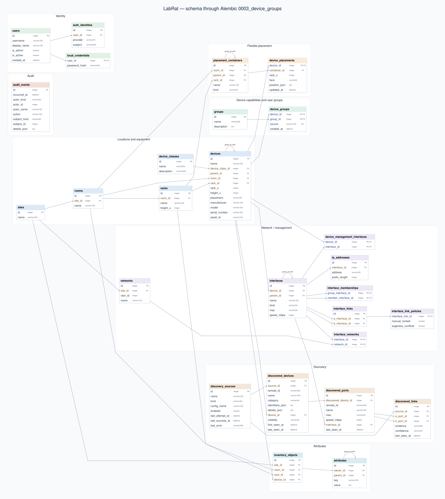

# LabRat schema at revision 0003_device_groups

This historical diagram is generated from the schema after Alembic revisions
`0001_initial`, `0002_discovery_foundation`, and `0003_device_groups`.
It covers physical inventory, flexible placements, typed attributes,
discovery observations, source-provenance, change auditing, authentication,
and the new capabilities/groups relationship.

Read [device-groups.md](device-groups.md) for the group design,
provenance rules, migration impact, and example queries.

Revisions 0004–0009 add columns and constraints without changing the table
count. For the current schema overview, migration notes, and diagram dates, see
[`database-schema.md`](database-schema.md). SQLAlchemy models and Alembic
migrations remain authoritative.
