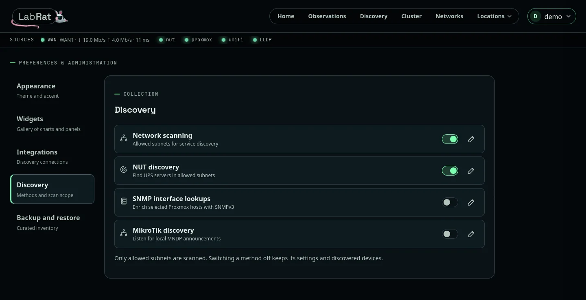
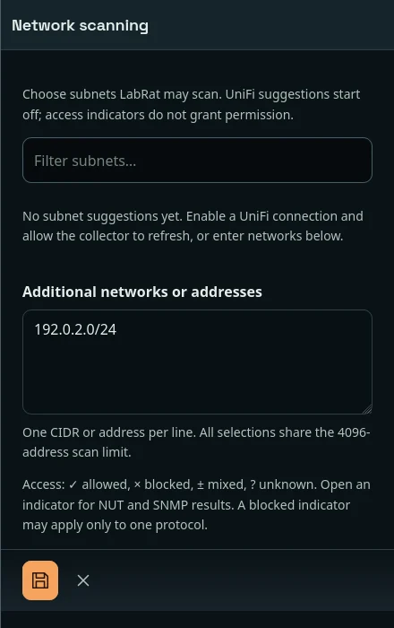

# Setting up LabRat

From a fresh checkout, or the sample containers, to a collector reading
your lab. The same guide, illustrated, ships inside the app at `/docs/setup`.

## Requirements

- Python 3.11 or newer, SQLite, and Git; or Docker with Compose (see
  [Run in containers](#run-in-containers))
- Network access from the collector to the controllers you connect

## Setup

### 1. Install

From the repository root:

```sh
python3 -m venv .venv
. .venv/bin/activate
python -m pip install -e .
cp local_config.example.toml local_config.toml
```

### 2. Write the private configuration

`local_config.toml` is ignored by Git and holds everything private: the
session key, the database path, the browser hosts LabRat accepts, and later
your integration credentials. Before the first start:

- Set `[auth].secret_key` to a new random value:
  `python -c 'import secrets; print(secrets.token_urlsafe(48))'`.
- Set `[server].allowed_hosts` to the hostnames or addresses people will type
  into their browsers. Without it, only loopback hosts are accepted.
- Leave the session cookie's secure flag off only for plain-HTTP development.

### 3. Create the database and start

```sh
alembic -c alembic.ini upgrade head
gunicorn -c gunicorn.conf.py labrat.app:app
```

Run the migration again after each upgrade; Flask never creates tables. Until
you do, every page shows a holding page with the command to run and the
revisions involved, and LabRat opens on its own a few seconds after the
migration finishes. Set `LABRAT_MIGRATE_ON_START=1` (or
`[server].migrate_on_start = true`) to have the web server migrate the
database itself while that page shows, as the container image does. The
checked-in Gunicorn config binds to `127.0.0.1:8000`. For a VM, container, or
reverse proxy, set a bind address in your deployment and add its hostname to
`allowed_hosts`.

### 4. Create the administrator

Open LabRat and select **First-time setup** to create the administrator.
The form asks for a one-time setup code, so nobody else who reaches the
page first can claim it: Gunicorn's output shows
`LabRat first-time setup code: …` when it starts, and the code is also in
the `.setup-code` file beside the database. Setup closes, and the code is
deleted, as soon as that account exists.

### 5. Connect your controllers

Open **Settings** from your name in the header, then **Integrations**.


Select **+** to open the catalog, choose a category, then the product, such
as UniFi Network (an API key), Proxmox VE (an API token ID and secret),
Pi-hole (an application password), or OPNsense (an API key and secret for a
user with only the privileges [the discovery guide](discovery-adapters.md#opnsense-optional) lists). Use read-only credentials. For Proxmox, `VM.Audit` on `/vms` also lets Discovery
recognize VMs and containers among network clients.

<p>
  
  
</p>

**Test connection** checks read-only access without saving. Certificate
checking is on by default; **Certificate settings** accepts your own CA
bundle, or turns checking off for a controller reached by IP address with a
self-signed certificate. Saved connections and credentials go into `local_config.toml`, never
the database, and a running collector picks them up
before its next full scan. Hand-written `[unifi]`, `[proxmox]`, and
`[integrations.*]` sections still work; see
[`local_config.example.toml`](../local_config.example.toml) and the
[collector guide](discovery-adapters.md).

### 6. Choose what the collector may scan

**Settings → Discovery** switches on each discovery method beyond your
controllers. Switching one off keeps its settings and what it found.



- **Network scanning** is the permission list: LabRat only contacts
  addresses inside the subnets you allow. UniFi suggests its networks, but
  each suggestion starts off; you can add networks or single addresses, one
  per line, within a shared 4096-address limit.
- **NUT discovery** finds UPS servers inside those subnets and reads them
  with list commands only. It never logs in to a UPS or sends it commands.
- **SNMP interface lookups** fill in NIC addresses and link state over
  SNMPv3 for the Proxmox nodes you name.
- **MikroTik discovery** listens for MNDP announcements and sends nothing.
  Announcements do not cross routers, so it hears only MikroTik devices on
  the collector's own segment; for others, run the standalone listener
  ("Standalone MNDP listener" in the [collector guide](discovery-adapters.md#standalone-mndp-listener)).



### 7. Run the collector

The collector is a separate, read-only process. Try one cycle, then list what
it stored:

```sh
python -m labrat.collector --once
python -m labrat.collector --list
```

Run it without either switch to keep polling (full scans every 60 seconds,
or what `[collector] interval_seconds` or `--interval` sets) under your service manager, beside the web app. It
reloads `local_config.toml` before each full scan, so Settings changes need
no restart. A source that fails keeps its last observations, marked stale.
The collector never creates canonical devices, chooses physical locations,
or changes canonical cabling.

### 8. Map your lab and back it up

Add a location and its areas in **Locations**, add racks in an area's Floor
plan, then place equipment from **Discovery**: create a new inventory record
(the default) or link the observation to an existing one.
**Settings → Export and import** moves a whole install to a new way of
hosting it. **Download export** gives one ZIP file with the entire database
(inventory, discoveries, accounts, history) and every integration,
credentials included, so store it like a password. **Import and replace**,
on the new install, replaces all of that with the export's contents and
signs you out; sign in with an account from the old install. The new
install keeps its own `[server]`, `[database]`, and `[auth]` settings,
which describe where it runs. An export from an older LabRat is migrated
as it is imported; one from a newer LabRat is refused.

## Run in containers

The repository has a sample image and Compose file, as a starting point
for your own deployment: one image runs either the web app or the
collector, and both share a data folder (the SQLite database) and a config
folder (`local_config.toml`).

```sh
mkdir -p deploy/data deploy/config
export LABRAT_UID=$(id -u) LABRAT_GID=$(id -g)
LABRAT_ALLOWED_HOSTS=labrat.example.lan \
  docker compose -f deploy/compose.yaml up -d --build
```

- **First start** writes `deploy/config/local_config.toml` from the example,
  with a new session key and `LABRAT_ALLOWED_HOSTS` (comma-separated) plus
  the loopback names as the accepted browser hosts; after that, edit the
  file like any other config. The web container answers at once with a
  holding page, migrates the database behind it, and then opens LabRat;
  the collector starts once the web app is healthy.
- **Check it:** `docker compose -f deploy/compose.yaml ps` shows `web` as
  healthy, and `curl http://127.0.0.1:8000/api/v1/health` answers
  `{"service":"labrat","status":"ok"}`.
- **Open** `http://<host>:8000` and choose **First-time setup**. The
  setup code is in `docker compose -f deploy/compose.yaml logs web` (or
  `deploy/data/labrat.sqlite3.setup-code`). Then carry on from step 5 above. Settings saves integrations into the config folder,
  so keep it writable. The collector rereads it before each full scan; to
  scan now, run `docker compose -f deploy/compose.yaml run --rm collector
  collector --once`, and `collector --list` shows what it stored.
- **Permissions and port:** both containers run as `LABRAT_UID:LABRAT_GID`
  (default 1000:1000), which must own the data and config folders. Set
  `LABRAT_PORT` to publish the app on a host port other than 8000.
- **MikroTik discovery** hears MNDP broadcasts only on the host's own
  network segment: uncomment `network_mode: host` on the collector in
  `deploy/compose.yaml` to use it. Controllers, NUT, and SNMP work from
  Compose's own network.
- **HTTPS:** put a reverse proxy in front, then set
  `[auth].secure_cookies = true` and add the proxy's hostname to
  `allowed_hosts`.
- **Upgrades:** pull the new code and run the same `up -d --build`; the web
  container applies new migrations on start.

**Published images.** Each release is also published to GitHub's
container registry for amd64 and arm64, as `ghcr.io/<owner>/labrat`
(the owner from the repository's GitHub address), tagged with its
version (`0.5.3`), its minor series (`0.5`, which moves to each newer
patch release), and `latest` (the newest release). Rebuilding an older
release, for a base-image fix, refreshes only that version's tag. To use one instead of building, set the
Compose file's `image:` to it and drop `--build`, or `docker pull` it.
Pin a version in production so an upgrade (and its migrations) happens
when you choose.

Without Compose, `docker build -t labrat .` builds the image, and
`docker run` takes `web` (the default) or `collector` plus collector
options, such as `collector --once`. Any other command runs as given, for
example `docker compose -f deploy/compose.yaml run --rm web alembic -c
alembic.ini current`.

## Run on Kubernetes

`deploy/kubernetes.yaml` is a sample deployment built from the same image:
one pod with a `config` init container, then the `web` and `collector`
containers, two volumes (data and config), a Service, and an HTTPS
Ingress. Use a published release image (see Published images above), or
build the image and push it to a registry your cluster can pull from; set
that name and your hostname in the file, and apply it:

```sh
docker build -t registry.example.lan/labrat:latest .
docker push registry.example.lan/labrat:latest
kubectl apply -f deploy/kubernetes.yaml
kubectl -n labrat logs deploy/labrat -c web   # the first-time setup code
```

- **One pod, one replica.** The web app and the collector share one SQLite
  file, so they run side by side in one pod, never scaled out. The
  Deployment uses `Recreate`, so an upgrade stops the old pod before the
  new one mounts the volumes. Put the data volume on block storage
  (ReadWriteOnce: Ceph RBD, Longhorn, a local volume); SQLite's locking is
  unreliable on NFS and other shared file systems.
- **Start order.** The `config` init container writes the config on first
  start, so the two containers never race to create it. The web container
  migrates the database itself while it shows a holding page, so an
  upgrade with a long migration shows its progress instead of nothing; the
  collector waits until the schema is current before it polls.
- **Hosts and probes.** LabRat answers only the hostnames in
  `[server].allowed_hosts`, so the Ingress hostname must be one of them
  (`LABRAT_ALLOWED_HOSTS` sets it on first start). The kubelet probes the pod
  by its address, which LabRat refuses, so the probes send `Host: localhost`.
  Both probes use `/api/v1/live`, which answers while LabRat starts or
  migrates, so the Service serves the holding page and a long migration
  never restarts the pod; `/api/v1/health` answers only once LabRat is
  ready.
- **HTTPS** ends at the Ingress; the sample sets `LABRAT_SECURE_COOKIES`,
  so the first config marks cookies HTTPS-only.
- **Upgrades and rollback.** With `latest`, push a new image and run
  `kubectl -n labrat rollout restart deploy/labrat`. With fixed tags, change
  the three `image:` lines; going back is the previous tag. Migrations only
  move forward, so export first (**Settings → Export and import**, or a
  volume snapshot) before an upgrade you may want to undo.
- **Resources.** The sample requests about 256 MiB for the web app (two
  Gunicorn workers) and 192 MiB for the collector; tune them to your lab's
  size.

### Discovery from inside a cluster

Almost everything LabRat reads travels over routed IP, so it works from
the pod network wherever the cluster can reach the lab:

- **Works as is:** controller and hypervisor APIs (UniFi, Proxmox, and the
  rest), SNMP, NUT and other probes within `[scan]` ranges, and the clients
  page's open-port check. Neighbour (LLDP), MAC, and ARP details come from
  the devices' own tables, so where LabRat runs does not change them.
- **Source address.** Pod traffic usually leaves with the node's address,
  not the pod's. Wherever a device or firewall allows LabRat by address (an
  SNMP access list, a controller's API allow list, a firewall rule), allow
  every node the pod may run on, or pin the pod to one node.
- **Network policies.** If the cluster restricts egress, allow the pod to
  reach your controllers' API ports, SNMP (UDP 161), and NUT (TCP 3493).
- **Needs the same network segment: MikroTik discovery (MNDP).** It only
  listens for broadcasts on UDP 5678, and broadcasts do not leave their
  segment, so a pod on the cluster network never hears them. Choose one:
  - **Leave MNDP off.** MikroTik devices still appear as LLDP neighbours of
    the UniFi switches LabRat reads, just with less detail.
  - **Host networking.** Uncomment `hostNetwork`, `dnsPolicy`, and
    `nodeSelector` in the sample to put the pod on the network of a node
    with an interface on the MikroTik's segment. The whole pod shares that
    node's network, so the web app listens on the node's port 8000, which
    must be free. The Service and Ingress keep working.
  - **A second interface.** With a multi-network plugin such as Multus, give
    the pod a macvlan interface on the MikroTik's VLAN, so the pod hears its
    broadcasts without sharing the node's network.
  - **A standalone listener.** Run `python -m labrat.collector.mndp_push`
    on any host (or a small host-network pod) on the MikroTik's segment.
    It reports what it hears over LabRat's API with a token, so the LabRat
    pod needs no layer-2 access at all. See "Standalone MNDP listener" in
    `docs/discovery-adapters.md`.

  A pod moved to another node by host networking or a second interface
  hears that node's segment, so pin it with `nodeSelector` or affinity.

## One instance per database

LabRat runs as one web server and one collector per database: SQLite
allows one writer, and sign-in limits and collector scheduling live in
memory. Each holds a lease in the database and renews it every 20
seconds, and gives it up when it stops cleanly. A lease not renewed
for 90 seconds is stale, so a server that crashed is replaced
automatically once that time has passed.

- **A second web server** on the same database shows a holding page
  naming the server that holds it (host, process, version, and when it
  last renewed). Sign in as an administrator to choose:
  - **Take over the database from here.** The other server steps down
    within 20 seconds and shows that it was replaced. Its collector stops
    too, and a waiting collector takes over.
  - **Leave that one alone and stop this one.** This server shuts down. A
    container platform that restarts it brings the page back.
  - **Fork it and keep my own copy.** This server copies the database
    beside the original (`<name>-fork-<time>.sqlite3`) and runs on the
    copy, apart from the other server, until it restarts. To keep using
    the copy, set `[database].path` to it. Its collector keeps writing to
    the original.
  Every choice is recorded in the audit log.
- **A second collector** waits for the first to stop, logging once a
  minute. `collector --on-conflict take-over` replaces it instead, and
  `--on-conflict refuse` exits with status 3. `[collector].on_conflict`
  sets the same choice in the config. A one-off `collector --once` (a
  "scan now") runs its cycle beside the running collector, with a warning,
  unless `--on-conflict` says otherwise.
