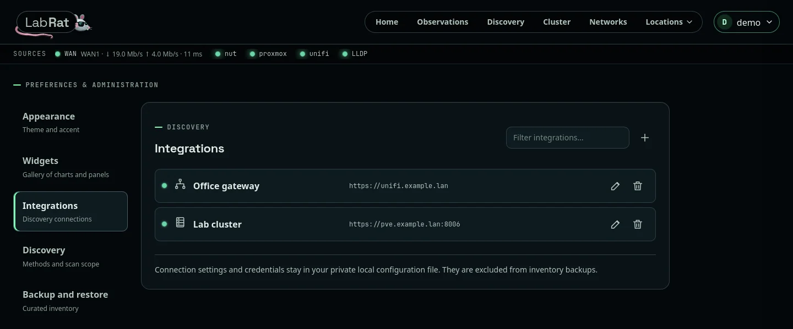
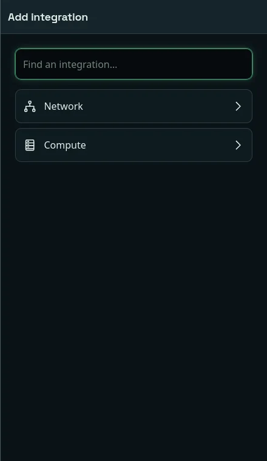
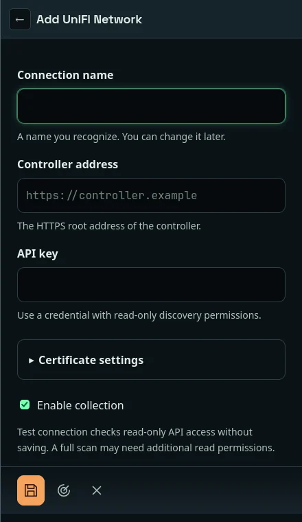

# Setting up LabRat

From a fresh checkout, or the sample containers, to a collector reading
your lab. The same guide, illustrated, ships inside the app at `/docs/setup`.

## Requirements

- Python 3.11 or newer, SQLite, and Git; or Docker with Compose (see
  [Run in containers](#run-in-containers))
- Network access from the collector to the controllers you connect

## Setup

### 1. Install

From the repository root:

```sh
python3 -m venv .venv
. .venv/bin/activate
python -m pip install -e .
cp local_config.example.toml local_config.toml
```

### 2. Write the private configuration

`local_config.toml` is ignored by Git and holds everything private: the
session key, the database path, the browser hosts LabRat accepts, and later
your integration credentials. Before the first start:

- Set `[auth].secret_key` to a new random value:
  `python -c 'import secrets; print(secrets.token_urlsafe(48))'`.
- Set `[server].allowed_hosts` to the hostnames or addresses people will type
  into their browsers. Without it, only loopback hosts are accepted.
- Leave the session cookie's secure flag off only for plain-HTTP development.

### 3. Create the database and start

```sh
alembic -c alembic.ini upgrade head
gunicorn -c gunicorn.conf.py labrat.app:app
```

Run the migration again after each upgrade; Flask never creates tables. The
checked-in Gunicorn config binds to `127.0.0.1:8000`. For a VM, container, or
reverse proxy, set a bind address in your deployment and add its hostname to
`allowed_hosts`.

### 4. Create the administrator

Open LabRat and select **First-time setup** to create the administrator.
The form asks for a one-time setup code, so nobody else who reaches the
page first can claim it: Gunicorn's output shows
`LabRat first-time setup code: …` when it starts, and the code is also in
the `.setup-code` file beside the database. Setup closes, and the code is
deleted, as soon as that account exists.

### 5. Connect your controllers

Open **Settings** from your name in the header, then **Integrations**.



Select **+** to open the catalog, choose a category, then the product, such
as UniFi Network (an API key), Proxmox VE (an API token ID and secret), or
Pi-hole (an application password). Use read-only credentials. For Proxmox, `VM.Audit` on `/vms` also lets Discovery
recognize VMs and containers among network clients.

<p>
  
  
</p>

**Test connection** checks read-only access without saving. Certificate
checking is on by default; **Certificate settings** accepts your own CA
bundle. Saved connections and credentials go into `local_config.toml`, never
the database or inventory backups, and a running collector picks them up
before its next full scan. Hand-written `[unifi]`, `[proxmox]`, and
`[integrations.*]` sections still work; see
[`local_config.example.toml`](../local_config.example.toml) and the
[collector guide](discovery-adapters.md).

### 6. Choose what the collector may scan

**Settings → Discovery** switches on each discovery method beyond your
controllers. Switching one off keeps its settings and what it found.


- **Network scanning** is the permission list: LabRat only contacts
  addresses inside the subnets you allow. UniFi suggests its networks, but
  each suggestion starts off; you can add networks or single addresses, one
  per line, within a shared 4096-address limit.
- **NUT discovery** finds UPS servers inside those subnets and reads them
  with list commands only. It never logs in to a UPS or sends it commands.
- **SNMP interface lookups** fill in NIC addresses and link state over
  SNMPv3 for the Proxmox nodes you name.
- **MikroTik discovery** listens for MNDP announcements and sends nothing.
  Announcements do not cross routers.


### 7. Run the collector

The collector is a separate, read-only process. Try one cycle, then list what
it stored:

```sh
python -m labrat.collector --once
python -m labrat.collector --list
```

Run it without either switch to keep polling (`--interval` sets the seconds
between full scans) under your service manager, beside the web app. It
reloads `local_config.toml` before each full scan, so Settings changes need
no restart. A source that fails keeps its last observations, marked stale.
The collector never creates canonical devices, chooses physical locations,
or changes canonical cabling.

### 8. Map your lab and back it up

Add a location and its areas in **Locations**, add racks in an area's Floor
plan, then place equipment from **Discovery**: create a new inventory record
(the default) or link the observation to an existing one.
**Settings → Backup and restore** downloads the curated inventory as JSON,
without accounts, credentials, or live observations; a restore previews its
changes before applying them.

## Run in containers

The repository has a sample image and Compose file, as a starting point
for your own deployment: one image runs either the web app or the
collector, and both share a data folder (the SQLite database) and a config
folder (`local_config.toml`).

```sh
mkdir -p deploy/data deploy/config
export LABRAT_UID=$(id -u) LABRAT_GID=$(id -g)
LABRAT_ALLOWED_HOSTS=labrat.example.lan \
  docker compose -f deploy/compose.yaml up -d --build
```

- **First start** writes `deploy/config/local_config.toml` from the example,
  with a new session key and `LABRAT_ALLOWED_HOSTS` (comma-separated) plus
  the loopback names as the accepted browser hosts; after that, edit the
  file like any other config. The web container migrates the database
  before it serves, and the collector starts once the web app is healthy.
- **Check it:** `docker compose -f deploy/compose.yaml ps` shows `web` as
  healthy, and `curl http://127.0.0.1:8000/api/v1/health` answers
  `{"service":"labrat","status":"ok"}`.
- **Open** `http://<host>:8000` and choose **First-time setup**. The
  setup code is in `docker compose -f deploy/compose.yaml logs web` (or
  `deploy/data/labrat.sqlite3.setup-code`). Then carry on from step 5 above. Settings saves integrations into the config folder,
  so keep it writable. The collector rereads it before each full scan; to
  scan now, run `docker compose -f deploy/compose.yaml run --rm collector
  collector --once`, and `collector --list` shows what it stored.
- **Permissions and port:** both containers run as `LABRAT_UID:LABRAT_GID`
  (default 1000:1000), which must own the data and config folders. Set
  `LABRAT_PORT` to publish the app on a host port other than 8000.
- **MikroTik discovery** hears MNDP broadcasts only on the host's own
  network segment: uncomment `network_mode: host` on the collector in
  `deploy/compose.yaml` to use it. Controllers, NUT, and SNMP work from
  Compose's own network.
- **HTTPS:** put a reverse proxy in front, then set
  `[auth].secure_cookies = true` and add the proxy's hostname to
  `allowed_hosts`.
- **Upgrades:** pull the new code and run the same `up -d --build`; the web
  container applies new migrations on start.

Without Compose, `docker build -t labrat .` builds the image, and
`docker run` takes `web` (the default) or `collector` plus collector
options, such as `collector --once`. Any other command runs as given, for
example `docker compose -f deploy/compose.yaml run --rm web alembic -c
alembic.ini current`.
