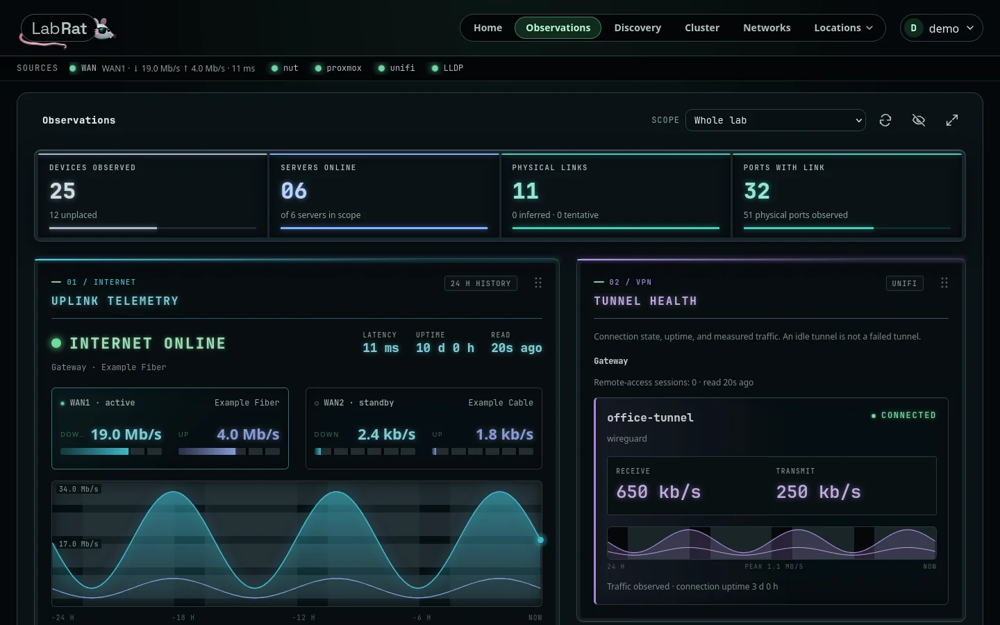
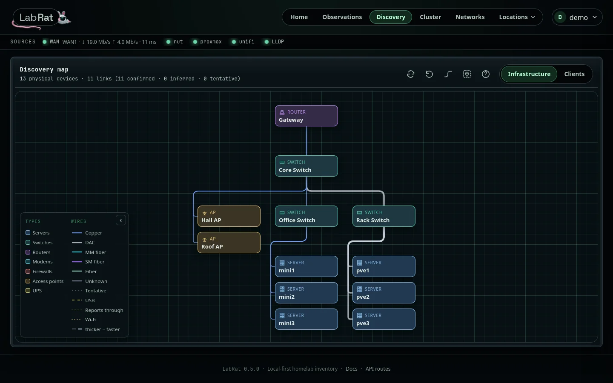
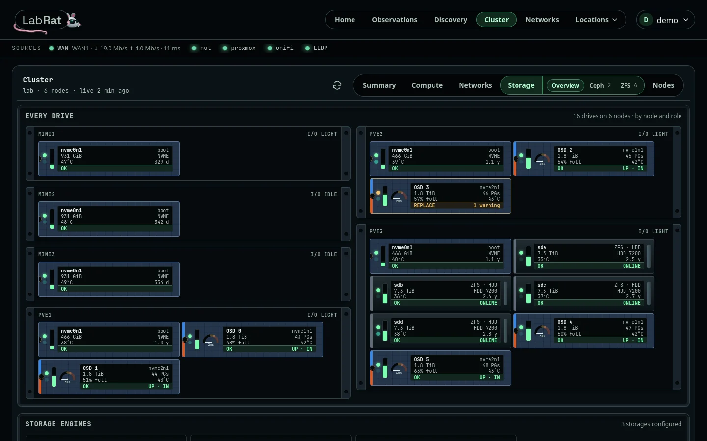
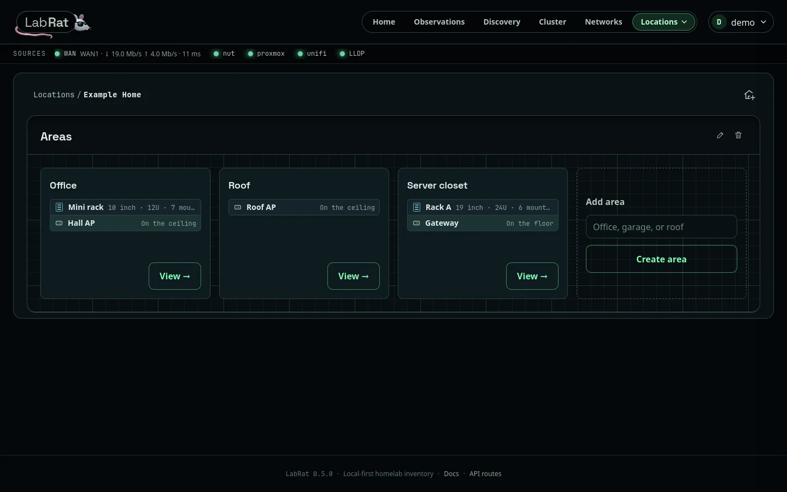
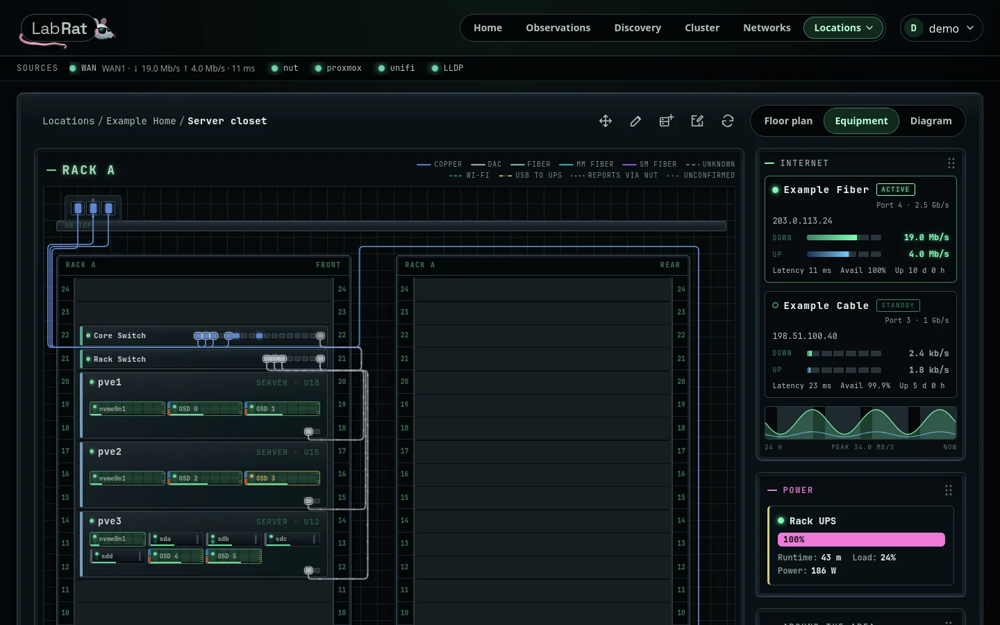

# A tour of LabRat

Every page, in the order the header lists them. The in-app version, with
more screenshots, is at `/docs/tour`.

- **Header:** Home, Observations, Discovery, Cluster, Networks, a
  **Locations** menu (each location with a flyout of its areas), and your
  account menu (Profile,
  Settings, Sign out). The **Sources** strip below it shows internet status
  and each collector source. Docs and the API reference are in the footer.
- **Home** (`/home`) summarizes the cache: counts, observed equipment by
  type, both internet connections and the VPN side by side, Lab health
  (live cluster and network charts, with what needs attention), and sources.
- **Observations** (`/observations`) is a live operations screen for the
  whole lab or one area: internet and VPN history, servers, UPS power, a
  watchlist, collector health, port state, and an activity log. It rereads
  the local cache every 15 seconds and never contacts a controller.
  Administrators can ignore a watchlist condition and restore it from
  **Ignored items**. **Wallboard** fills the screen; Escape exits.

  

- **Discovery** (`/topology`) draws physical equipment as a tree (routers,
  switches by hop, then what hangs from them) in **Infrastructure**, and
  lists UniFi's wired and Wi-Fi endpoints in **Clients**. Select a device to
  inspect or place it. Clients join inventory only when you add them, and a
  device's details drawer has a tab for each kind of link it reports
  (Switch, WAN, Bridges, VLANs, IP, VPN).

  

- **Cluster** (`/cluster`) shows the Proxmox cluster: a Summary with an
  attention list and charts, Compute (guests), Networks (bridges and
  VLANs), Storage (every drive as a hot-swap bay, plus ZFS and Ceph pool
  shelves), and Nodes, one screen per node that reloads every 30 seconds.

  

- **Networks** (`/networks`) shows what UniFi knows: an overview with DNS
  sinkholes such as Pi-hole, firewall zones and who can reach whom,
  networks, Wi-Fi, devices, and clients.
- **Locations** (`/locations`, or the location itself when there is only
  one) draws each location as a building of area cards listing what sits at
  each area's top level. Add, rename, and delete locations and areas here
  and from an area's heading (Edit area). A delete says what goes with it;
  equipment is unplaced, never deleted.

  

- **Areas** (`/areas/<id>`) open **Equipment** when they have racks,
  otherwise **Diagram**; pill tabs switch between all three views
  (`/areas/<id>/floor-plan`, `/equipment`, `/wiring`).
  - **Floor plan** is a dimensionless top-down layout of racks, shelves, and
    equipment footprints on the floor, walls, shelves, and rack tops.
  - **Equipment** shows every rack's front and rear elevations, faceplates
    with port lamps, cables between the ports they really use, and a
    Proxmox node's drives as hot-swap bays, beside the area's internet and
    UPS panels. Arrange mode moves equipment by drag
    and drop or arrow keys and saves every move together. A NUT server's
    USB link to its UPS is drawn separately and never counted as a cable.
  - **Diagram** reads left to right from the internet, showing only wired
    ports; cables leaving the area end on a patch panel along the top.
    Select a device to light its routes to the gateway.

  

- **Settings** (`/settings`): **Appearance** picks this browser's theme
  (Disco, the default control-room look; Dark; Light; or Match my system)
  and accent; administrators also get Integrations, Discovery, and Export
  and import.
- **Docs** (`/docs`) has these guides, illustrated, plus an API reference
  generated from the running route map.

Discovery links keep their source, evidence, and confidence. Confirmed and
inferred links are trusted by default; ambiguous ones stay tentative.
Explicit port-down state wins over reported speed, and moving equipment
never rewrites discovered links.
